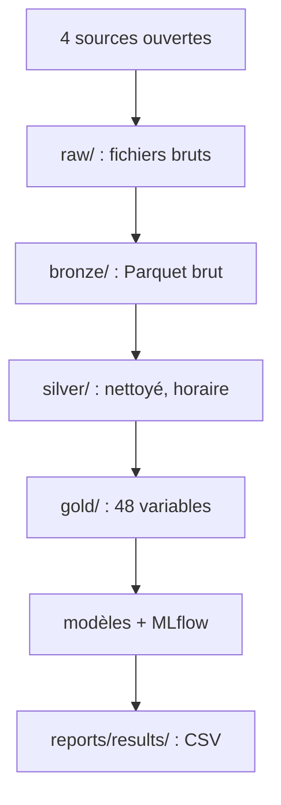
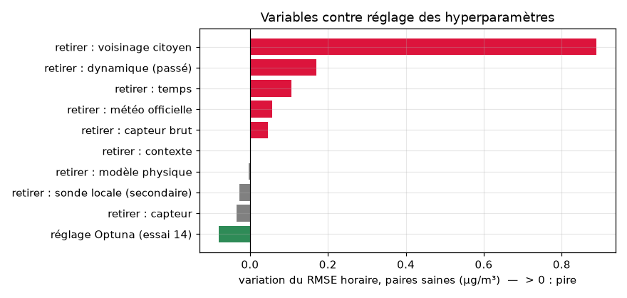
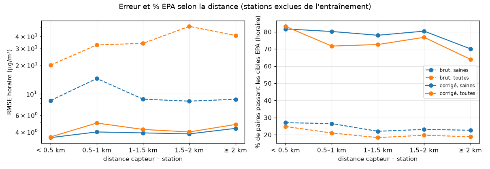
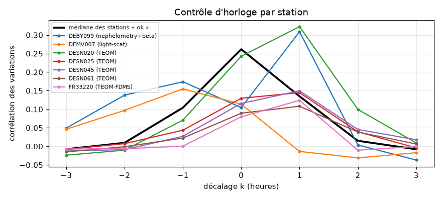

# air-calib — rendre un capteur de pollution à 30 € aussi fiable qu'une station officielle

Nous avons corrigé, par apprentissage automatique, les mesures de particules fines (PM2.5) d'un capteur citoyen à
environ 30 € (le SDS011 du réseau Sensor.Community), en le comparant aux stations officielles de l'Agence européenne de
l'environnement, sur 2024–2025, en Allemagne puis en France. Chaque modèle est évalué sur des **stations qu'il n'a
jamais vues**, avec les cibles de performance de l'agence américaine de l'environnement (EPA). Toute la chaîne, des
1,2 million de fichiers bruts aux modèles, tourne en local et se relance par une commande.

> **Le chiffre clé.** Sur des stations jamais vues, la part des capteurs sains qui passent les cibles EPA en horaire
> passe de **25 % à 80 %** (de 39 % à 85 % en journalier). Le $R^2$ médian par capteur passe de **0,68 à 0,87**
> (le $R^2$ regroupé sur toutes les heures, de 0,18 à 0,76).

## Par où commencer

Ouvrez **[`notebooks/00_synthese_du_projet.ipynb`](notebooks/00_synthese_du_projet.ipynb)**. Il raconte tout le
projet en dix sections, en quelques minutes de lecture, et s'exécute en moins de 10 secondes **sans aucune donnée** (il ne
lit que les petits fichiers de [`reports/results/`](reports/results/) et les figures de
[`reports/figures/`](reports/figures/)). Chaque section renvoie au notebook détaillé qui contient la preuve.

## La question business

Une collectivité, un promoteur ou un assureur qui veut connaître la pollution **rue par rue** ne peut pas se payer des
stations officielles (plusieurs dizaines de milliers d'euros chacune). Il lui faut des capteurs bon marché, mais justes.

- **Peut-on corriger un capteur à 30 € pour qu'il approche une station officielle ?**
- **Jusqu'à quelle distance d'une station la correction reste-t-elle fiable ?**

**Notre réponse.** Oui : corrigé par un modèle appris sur d'autres stations, un capteur SDS011 en bon état passe les
cibles de l'EPA dans 80 % des cas en horaire et 85 % en journalier, et cela tient jusqu'à 3 km d'une station (70 à 82 %
selon la distance ; 81 à 92 % quand le capteur a au moins 3 voisins citoyens). La vraie limite est la densité du réseau
citoyen, puis le temps : sans voisins, moins d'un capteur sur deux passe ; sur les mêmes stations, le modèle appris en
2024 tient en 2025 (82 % en horaire), mais appliqué à de nouvelles stations l'année suivante il perd 15 points, d'où un
réapprentissage annuel. Le modèle allemand ne se transpose pas tel quel en France (23 % des capteurs sains en horaire),
où 61 % des heures n'ont pas de voisins : il y faut une calibration locale.

## Les données

Quatre sources ouvertes, coût 0 €. Volumes réels du projet :

| Source | Rôle | Volume | Licence et attribution |
|---|---|---|---|
| [Sensor.Community](https://sensor.community), archive [`archive.sensor.community`](https://archive.sensor.community) | mesures brutes des capteurs citoyens (SDS011) et de leurs sondes d'humidité | 1 208 730 fichiers jour (5,85 Go compressés), 667,7 millions de lignes | ODbL 1.0 — « données © contributeurs Sensor.Community » |
| [Agence européenne de l'environnement (EEA)](https://eeadmz1-downloads-webapp.azurewebsites.net/), données E1a vérifiées | vérité terrain : PM2.5 horaire des stations officielles, avec leur type et leur méthode de mesure | 582 fichiers (814 Mo), 298 stations | CC BY 4.0 — « © European Environment Agency » |
| [Deutscher Wetterdienst (DWD)](https://opendata.dwd.de) | humidité et température officielles, Allemagne | 222 stations (343 Mo) | CC BY 4.0 — « Source : Deutscher Wetterdienst » |
| [Météo-France](https://www.data.gouv.fr/fr/datasets/donnees-climatologiques-de-base-horaires/), données climatologiques horaires | humidité et température officielles, France | 118 fichiers (2,0 Go reçus, 11 Mo gardés) | Licence Ouverte Etalab 2.0 — « Source : Météo-France » |

Après nettoyage : **13,8 millions d'heures-paires** (une heure où un capteur et sa station ont chacun une mesure
valide), dont 4,67 millions servent à l'apprentissage (Allemagne, 1,5 km ou moins, capteurs vérifiés). Sur disque :
bronze 5,3 Go, silver 2,7 Go, gold 1,2 Go ([`reports/results/volumes_couches.csv`](reports/results/volumes_couches.csv)).

## Le pipeline



Le nettoyage **ne supprime aucune ligne** : chaque mesure garde un statut (`ok` ou la première règle qu'elle viole), et
le rapport d'entonnoir [`reports/funnel.md`](reports/funnel.md) compte ce que chaque règle retire. Seules des règles
physiques et de cohérence s'appliquent ; aucun filtre statistique d'aberrations.

## Le processus expérimental

1. **Faisabilité** (notebook 01) : inventaire des capteurs et des stations, contrôle de l'horloge, décision GO.
2. **Ingestion et nettoyage** (notebooks 02–03) : téléchargement complet sans échec, contrats de données Pandera,
   règles de nettoyage justifiées par les données, contrôle d'horloge sur chaque paire.
3. **Exploration** (notebook 04) : le « avant » et ce dont dépend l'erreur.
4. **Variables** (notebook 05) : un modèle physique et 48 variables, sans référence ni futur.
5. **Modèles** (notebook 06) : une échelle de six modèles sur 5 plis par station, puis des études annexes (ablation,
   échelle, contrainte, réglage), toutes suivies dans MLflow.
6. **Robustesse** (notebook 07) : temps, distance, France, découpages, intervalle de prédiction.

**Le protocole.** Les stations allemandes sont réparties en 5 plis. Le modèle apprend sur 4 plis et est évalué sur le
5ᵉ, cinq fois : une station et tous ses capteurs ne sont jamais à la fois en apprentissage et en test. Chaque résultat
est donné pour les **capteurs sains** et pour **tous les capteurs** (défectueux compris), et pour les heures **avec**
et **sans** voisins citoyens.

## Les choix et leurs limites

Chaque décision est justifiée en détail, avec ses chiffres, dans [`docs/JOURNAL.md`](docs/JOURNAL.md).

| Décision | Preuve | Ce que nous perdons ou risquons |
|---|---|---|
| Horloge EEA : `heure_UTC = Start − 1 h`, France comprise | corrélation maximale à +1 h pour 7 paires sur 7 ; sans correction, 207 stations sur 216 seraient rejetées | — |
| Humidité **officielle** en entrée principale | quand la sonde du capteur sature, la station officielle ne l'est que 2,1 % du temps | l'humidité vient d'une station à 6,4 km en médiane |
| Mois de sonde « morts » au-delà de X = 0,3 | au-delà, même les heures non saturées dérivent (+13,8 points pour la DHT22) | 0,54 million d'heures de sonde par rapport à X = 0,5 ; effet sur le modèle négligeable |
| Valeur « figée » = code de panne, ou station qui varie de 5 µg/m³ | la règle simple retirait surtout l'air propre (36,9 % contre 29,7 % sous 5 µg/m³) | les plateaux à zéro restent figés |
| Capteurs déplacés : un appariement par segment de position | 65 capteurs ont bougé, dont un depuis Hanoï | — |
| Paires invérifiables exclues de l'apprentissage, gardées pour l'évaluation | R² médian 0,03, aucune ne passe les cibles en horaire | les apprendre aurait gagné 3 paires sur 95 (dans le bruit) |
| Humidité plafonnée à 95 % dans le modèle physique | l'erreur change à peine entre 90 et 95 %, se dégrade au-delà | κ devient un paramètre effectif |
| Cible en µg/m³ plutôt qu'en log | +1,3 point de capteurs sains dans les cibles | +0,16 µg/m³ d'erreur sur les capteurs défectueux |
| Sonde locale retirée du modèle | effet de ±0,03 µg/m³, de signe changeant | aucun ; le produit n'exige plus de sonde d'humidité |
| Contrainte monotone, pas de recalibration de la pente | contrainte sans perte ; recalibrer coûtait +19 % de RMSE | — |

**Limites principales.** Les heures sans voisins citoyens (21 % en Allemagne, 61 % en France) restent sous les cibles ;
le modèle doit être réappris chaque année pour de nouvelles stations ; les stations industrielles et les références
TEOM en horaire échouent ; le chiffre de référence est optimiste d'au plus 0,07 µg/m³ (hyperparamètres choisis sur les
mêmes plis) ; rien n'a été mesuré au-delà de 3 km.

## Les résultats

**L'échelle de modèles** (capteurs sains, horaire, 5 plis par station ;
[`reports/results/echelle_de_modeles.csv`](reports/results/echelle_de_modeles.csv)) :

| Modèle | RMSE (µg/m³) | $R^2$ regroupé | Pente EPA | % dans les cibles, horaire / journalier |
|---|---|---|---|---|
| Capteur brut | 11,03 | 0,18 | 0,62 | 24,8 / 39,1 |
| Régression linéaire en log | 6,03 | 0,40 | 0,48 | 11,8 / 20,3 |
| Modèle physique (gain + humidité) | 19,47 | 0,16 | 1,11 | 26,4 / 35,2 |
| LightGBM, 48 variables | 3,95 | 0,74 | 0,81 | 76,7 / 85,6 |
| **Modèle retenu** (LightGBM en µg/m³, 45 variables, réglé) | **3,84** | **0,76** | **0,82** | **79,7 / 85,3** |

**Les tests de robustesse** (capteurs sains, % dans les cibles, horaire / journalier ;
[`temporel.csv`](reports/results/temporel.csv), [`distance.csv`](reports/results/distance.csv),
[`france.csv`](reports/results/france.csv)) :

| Test | Toutes heures | Avec voisins | Sans voisins |
|---|---|---|---|
| Référence (5 plis, Allemagne ≤ 1,5 km) | 79,7 / 85,3 | 88,3 / 92,0 | 42,1 / 58,6 |
| Nouvelles stations, appris en 2024, testé en 2025 | 69,5 / 81,2 | 79,0 / 89,0 | 38,9 / 52,3 |
| Témoin : nouvelles stations, appris et testé en 2025 | 84,3 / 88,9 | 92,0 / 93,2 | 55,8 / 69,8 |
| Mêmes stations, appris en 2024, testé en 2025 | 82,0 / 92,1 | 89,2 / 96,3 | 60,0 / 75,3 |
| Capteurs à moins de 0,5 km | 81,7 / 88,3 | 87,4 / 90,9 | 50,0 / 66,7 |
| Capteurs à 2–3 km | 70,1 / 80,1 | 81,2 / 91,3 | 49,2 / 60,0 |
| France, sans réajustement (brut : 15,8 / 24,2) | 22,8 / 35,2 | 50,0 / 52,9 | 12,7 / 24,2 |

**Ce qui fait la performance : les variables, pas le réglage.** Retirer la médiane des capteurs voisins augmente
l'erreur de 21 % ; le réglage automatique des hyperparamètres ne rapporte que 2 %.



**La distance compte peu jusqu'à 3 km** (traits pleins : capteur corrigé ; pointillés : capteur brut) :



**Un exemple de contrôle : l'horloge des stations**, vérifiée sur toutes les stations (la courbe noire, médiane des
stations conformes, culmine au bon alignement ; les stations TEOM répondent avec une demi-heure de retard) :



## Où trouver quoi

| Livrable demandé | Où |
|---|---|
| Code d'acquisition des données (`.py`) | [`src/aircalib/ingest/`](src/aircalib/ingest/) : inventaire, plan, téléchargement asynchrone avec reprise, conversion bronze |
| Code de nettoyage et de transformation (`.py`) | [`src/aircalib/transform/`](src/aircalib/transform/) (règles pures, testées), [`src/aircalib/silver/`](src/aircalib/silver/), [`src/aircalib/gold/`](src/aircalib/gold/), contrats [`src/aircalib/schemas/`](src/aircalib/schemas/) |
| Notebooks d'exploration | [`01`](notebooks/01_sources_et_faisabilite.ipynb) sources et faisabilité, [`02`](notebooks/02_ingestion_bronze.ipynb) ingestion, [`03`](notebooks/03_nettoyage_silver.ipynb) nettoyage, [`04`](notebooks/04_exploration_paires.ipynb) exploration, [`05`](notebooks/05_features_gold.ipynb) variables |
| Notebooks d'entraînement et d'évaluation | [`06`](notebooks/06_modeles.ipynb) modèles, [`07`](notebooks/07_evaluation_finale.ipynb) évaluation finale ; code [`src/aircalib/models/`](src/aircalib/models/), [`src/aircalib/evaluation/`](src/aircalib/evaluation/) |
| Synthèse | [`00`](notebooks/00_synthese_du_projet.ipynb), résultats en CSV dans [`reports/results/`](reports/results/) |
| Dépendances | [`requirements.txt`](requirements.txt) (généré depuis `uv.lock`), [`pyproject.toml`](pyproject.toml) |
| Tests | [`tests/`](tests/) : 123 tests sur de petits jeux de données écrits à la main |
| Journal des problèmes et décisions, plan | [`docs/JOURNAL.md`](docs/JOURNAL.md), [`docs/PLAN.md`](docs/PLAN.md) |
| Configuration unique | [`configs/default.yaml`](configs/default.yaml) |

## Glossaire

- **PM2.5** : masse des particules de diamètre inférieur à 2,5 micromètres, en µg/m³.
- **Capteur citoyen** : boîtier à bas coût installé par un particulier ; ici le SDS011, un compteur optique.
- **Station de référence** : station réglementaire dont les mesures sont vérifiées ; notre vérité terrain.
- **Paire** : un capteur (sur une position donnée) associé à sa station la plus proche.
- **Heure-paire** : une heure où un capteur et sa station ont chacun une mesure valide.
- **Couches bronze / silver / gold** : données brutes typées / nettoyées et horaires / prêtes pour les modèles.
- **Paire saine / invérifiable** : capteur dont les variations suivent sa station / capteur qui ne la suit pas
  (généralement défectueux).
- **Voisins citoyens** : les autres capteurs citoyens à 3 km ou moins ; leur médiane est notre meilleure variable.
- **Pli** : un groupe de stations ; le modèle apprend sur 4 plis et est évalué sur le 5ᵉ.
- **Fuite d'information** : une information disponible à l'évaluation mais pas en service (la référence, le futur, une
  station déjà vue), qui rend les scores trop beaux.
- **RMSE** : racine de la moyenne des carrés des écarts prédiction − référence, en µg/m³.
- **R²** : part de la variation de la référence que la prédiction reproduit (0 à 1).
- **Cibles EPA** : $R^2 \ge 0{,}70$, pente entre 0,65 et 1,35, ordonnée entre −5 et +5 µg/m³, RMSE ≤ 7 µg/m³.
- **LightGBM** : un modèle fait de centaines d'arbres de décision, chacun corrigeant les erreurs des précédents.
- **Prédiction conforme** : élargissement d'un intervalle de prédiction calculé sur les erreurs d'autres stations,
  pour qu'il tienne sa couverture annoncée.

## Reproduire

**Prérequis** : Python 3.12, environ 20 Go de disque libre au plus fort (10 Go au final), une connexion internet pour
le téléchargement. Testé sur macOS (Apple Silicon).

**Sur macOS**, installez d'abord OpenMP :

```bash
brew install libomp
```

LightGBM a besoin de la bibliothèque OpenMP, que macOS ne fournit pas. Sans Homebrew, la commande `train` se rabat sur
la copie d'OpenMP livrée avec scikit-learn, mais un simple `import lightgbm` (dans un notebook, par exemple) échouerait.

**Avec [uv](https://docs.astral.sh/uv/)** (recommandé) :

```bash
git clone https://github.com/lwdata75/air-calib.git && cd air-calib
make setup      # uv sync --frozen : l'environnement exact de uv.lock
make test       # 123 tests hors ligne (≈ 15 s)
make sample     # tout le pipeline sur 10 capteurs par pays et un mois (≈ 7 min, 0,4 Go, réseau requis)
make data       # volume complet : ≈ 3 h de téléchargement, 13 min de bronze, 5 min de silver et gold (≈ 9 Go)
make train      # étape 6 : échelle de modèles, études annexes, modèle final (≈ 1 h 30, suivi MLflow)
make evaluate   # étape 7 : temps, distance, France, découpages, intervalle (≈ 30 min)
uv run python -m aircalib export   # régénère reports/results/*.csv
make notebooks  # réexécute tous les notebooks (≈ 4 min)
```

**Avec pip seul** :

```bash
python3.12 -m venv .venv && source .venv/bin/activate
pip install -r requirements.txt   # installe aussi le paquet aircalib (ligne « -e . »)
pip install pytest                # pour les tests
python -m pytest -m "not network"
jupyter nbconvert --to notebook --execute notebooks/00_synthese_du_projet.ipynb --output /tmp/00.ipynb
python -m aircalib --help         # toutes les commandes : discover, download, bronze, silver, pair, features, train, export
```

Les données sont écrites dans `data/`, le suivi des modèles dans `mlflow.db` et `mlruns/` (interface : `make mlflow`) ;
rien de tout cela n'est versionné. Seuls les résultats légers (`reports/results/`, `reports/figures/`) le sont.

## Utilisation des LLM

Ce projet a été réalisé avec l'aide de **Claude Code** (Anthropic), un assistant de programmation, comme le cours
l'autorise. Nous avons fixé la question, le périmètre et les règles du projet, validé chaque étape avant la suivante
(les « feux verts » de [`docs/PLAN.md`](docs/PLAN.md)) et tranché les décisions. L'assistant a écrit une grande partie
du code, des tests et des notebooks sous cette direction, et a proposé des vérifications que nous avons retenues ou non.
Chaque chiffre de ce dépôt est calculé par le code sur les vraies données, jamais rédigé de mémoire. Pour la
transparence, nous gardons le fichier d'instructions de l'assistant ([`CLAUDE.md`](CLAUDE.md)) et le journal complet
des problèmes et des décisions ([`docs/JOURNAL.md`](docs/JOURNAL.md)), y compris les erreurs corrigées en route.

## Auteurs

[NOMS DU GROUPE]

## Références

- Liu, H.-Y., Schneider, P., Haugen, R. et Vogt, M. (2019). *Performance Assessment of a Low-Cost PM2.5 Sensor for a
  near Four-Month Period in Oslo, Norway.* Atmosphere, 10(2), 41. https://doi.org/10.3390/atmos10020041
- Duvall, R. M. et al. (2021). *Performance Testing Protocols, Metrics, and Target Values for Fine Particulate Matter
  Air Sensors.* U.S. EPA, EPA/600/R-20/280.
- Crilley, L. R. et al. (2018). *Evaluation of a low-cost optical particle counter (Alphasense OPC-N2) for ambient air
  monitoring.* Atmospheric Measurement Techniques, 11, 709–720. https://doi.org/10.5194/amt-11-709-2018
- Petters, M. D. et Kreidenweis, S. M. (2007). *A single parameter representation of hygroscopic growth and cloud
  condensation nucleus activity.* Atmospheric Chemistry and Physics, 7, 1961–1971.
- Duan, N. (1983). *Smearing Estimate: A Nonparametric Retransformation Method.* Journal of the American Statistical
  Association, 78(383), 605–610.
- Romano, Y., Patterson, E. et Candès, E. (2019). *Conformalized Quantile Regression.* NeurIPS 2019.
- Ke, G. et al. (2017). *LightGBM: A Highly Efficient Gradient Boosting Decision Tree.* NeurIPS 2017.

Licence du code : [MIT](LICENSE). Les données restent sous la licence de leur producteur (voir « Les données »).
