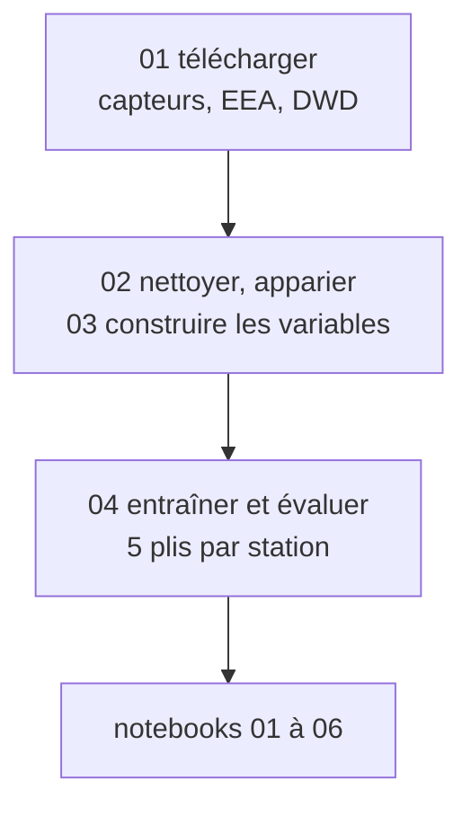
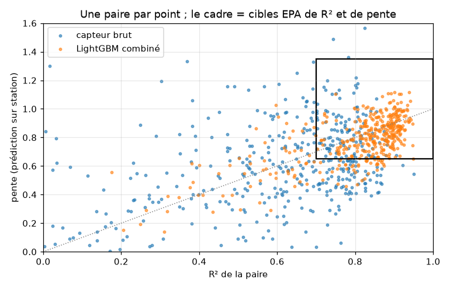

# air-calib (version simple) — corriger un capteur de particules fines à 30 €

On corrige par apprentissage automatique les mesures de PM2.5 du SDS011, le capteur citoyen le plus répandu du réseau
Sensor.Community, en le comparant aux stations officielles de l'Agence européenne de l'environnement (EEA). Périmètre :
l'Allemagne, en 2024 et 2025. Chaque modèle est évalué sur des **stations qu'il n'a jamais vues**, avec les cibles de
l'agence américaine de l'environnement (EPA) pour les capteurs à bas coût.

> **Le chiffre clé.** Sur 419 paires capteur–station saines, la part des capteurs qui passent les cibles EPA passe de
> **25 % à 76 %** en horaire, et de **41 % à 87 %** en moyenne journalière. Le RMSE passe de 12,4 à 3,7 µg/m³.

Une version plus poussée de ce travail se trouve sur la branche main.

## La question métier

Une collectivité qui veut connaître la pollution rue par rue ne peut pas installer des stations officielles partout
(plusieurs dizaines de milliers d'euros chacune). **Une fois corrigé, un capteur à environ 30 € donne-t-il une mesure assez
proche d'une station pour être utile là où il n'y en a pas ?**

**Notre réponse : oui, avec des conditions.**
- Trois capteurs corrigés sur quatre passent les cibles EPA en horaire, et près de neuf sur dix en journalier.
- Le capteur corrigé repère 73 % des jours de dépassement de la valeur guide de l'OMS (15 µg/m³ sur 24 h), contre
  39 % pour le capteur brut.
- Mais il faut que le capteur ait des capteurs voisins : sans voisins, seulement 44 % des paires passent les cibles.
- Et le modèle sous-estime encore les pics.
- Enfin, il faut le réapprendre régulièrement : appris sur une seule année, il ne passe plus les cibles que pour
  60 à 65 % des paires l'année suivante (notebook 06).

Ces chiffres sont mesurés sur des capteurs à 1,5 km ou moins d'une station que le modèle n'a jamais vue. Pour un
capteur vraiment loin de toute station, ils restent une estimation, pas une mesure.

## Les données

| Source | Rôle | Licence |
|---|---|---|
| [Sensor.Community](https://sensor.community) ([archive](https://archive.sensor.community)) | mesures des SDS011 : 569 capteurs appariés et 808 voisins, ≈ 675 000 fichiers jour | ODbL 1.0 — « © contributeurs Sensor.Community » |
| [EEA](https://eeadmz1-downloads-webapp.azurewebsites.net/), données E1a | référence : PM2.5 horaire de 179 stations | CC BY 4.0 — « © European Environment Agency » |
| [DWD](https://opendata.dwd.de) | humidité et température horaires, 107 stations | CC BY 4.0 — « Source : Deutscher Wetterdienst » |

Rien n'est versionné dans `data/` (2,9 Go une fois téléchargé). Licence du code : [MIT](LICENSE).

## Le pipeline en trois étapes



1. **Télécharger** (`scripts/01_telecharger.py`) : les stations EEA, les capteurs à 1,5 km ou moins d'une station, leurs
   voisins à 3 km ou moins, et la météo du DWD.
2. **Nettoyer et préparer** (`02_nettoyer.py`, `03_construire_variables.py`) : sept règles de nettoyage, le contrôle de
   chaque paire, puis 14 variables (capteur, météo, temps, passé récent, voisins).
3. **Entraîner et évaluer** (`04_entrainer.py`) : validation croisée en 5 plis par station, journal des essais dans
   `reports/runs.csv` et tableau de résultats dans `reports/resultats.csv`.

Les notebooks racontent le chemin, dans l'ordre :
- [01 — les données brutes](notebooks/01_donnees_brutes.ipynb) ;
- [02 — le nettoyage et l'« avant »](notebooks/02_nettoyage_et_appariement.ipynb) ;
- [03 — l'entraînement sur 20 % des stations](notebooks/03_entrainement.ipynb) ;
- [04 — les résultats](notebooks/04_resultats.ipynb) ;
- [05 — la contre-vérification](notebooks/05_contre_verification.ipynb) : les métriques recalculées à la main, sans
  `src/`, pour vérifier qu'elles ne dépendent pas d'un bug ;
- [06 — la robustesse de l'évaluation](notebooks/06_robustesse.ipynb) : intervalles de confiance, plis par région
  et validation dans le temps.

Le [journal de bord](docs/JOURNAL.md) garde les problèmes rencontrés et nos décisions.

## Nos choix

1. **L'heure de l'EEA est décalée d'une heure.** On le vérifie sur 37 paires et on corrige : heure UTC = Start − 1 h.
2. **L'humidité vient du DWD, pas de la sonde du capteur.** En hiver, les sondes DHT22 et BME280 sont bloquées à
   100 % la majorité du temps.
3. **Nettoyage seulement physique, pas de filtre statistique.** Un vrai pic de pollution ressemble à une valeur
   aberrante, et c'est justement ce qu'on veut apprendre à corriger.
4. **Les paires qui ne suivent pas leur station sont exclues de l'apprentissage** (122 sur 541), mais évaluées à part.
5. **Validation par station.** Une station et ses capteurs ne sont jamais à la fois en apprentissage et en test.
6. **On choisit sur un échantillon de 20 % des stations, puis on chiffre sur toutes.** L'ordre des modèles est le même
   dans les deux cas.
7. **Les capteurs voisins, même non appariés.** Ils font passer la part des heures avec voisins de 60 % à 79 %. C'est
   notre levier principal.
8. **Le modèle retenu combine deux LightGBM**, avec voisins et sans voisins, selon que le capteur a des voisins ou non.
   Il n'utilise aucune variable sur la station, puisqu'il n'y en a pas là où on veut corriger.

## Les résultats

Paires saines, validation croisée en 5 plis par station ([`reports/resultats.csv`](reports/resultats.csv)) :

| Modèle | RMSE (µg/m³) | R² médian par paire | Pente médiane | % de paires EPA, horaire / journalier |
|---|---|---|---|---|
| Capteur brut | 12,42 | 0,69 | 0,62 | 25,3 / 40,9 |
| Régression linéaire (PM2.5, humidité, température) | 7,05 | 0,38 | 0,19 | 0,0 / 0,0 |
| LightGBM, réglages par défaut | 3,79 | 0,85 | 0,80 | 74,0 / 84,8 |
| LightGBM, réglage 1 (apprentissage plus lent, 500 arbres) | 3,73 | 0,86 | 0,81 | 75,7 / 86,5 |
| LightGBM sans les variables de voisins | 4,70 | 0,79 | 0,68 | 49,6 / 65,4 |
| **Modèle retenu (combiné)** | **3,74** | **0,85** | **0,80** | **75,7 / 86,5** |

Le modèle combiné a été choisi sur l'échantillon de 20 % des stations, où il faisait mieux que le réglage 1 (RMSE 4,60
contre 4,75). Sur toutes les stations, les deux se valent. On garde le combiné : il a été choisi avant de voir ces
chiffres, et il s'entraîne presque deux fois plus vite (17 s contre 30 s).

**Quelle confiance accorder à ces chiffres ?** Le notebook 06 les met à l'épreuve, sur un nouveau téléchargement
de l'archive (qui donne 75,2 % au lieu de 75,7 %) :
- un bootstrap par station donne un intervalle à 95 % d'environ **68 à 82 %** de paires EPA en horaire. L'écart
  entre le combiné et le réglage 1 contient zéro : les deux sont indistinguables ;
- avec des plis par région (stations à 10 km ou moins dans le même pli), on perd environ 3 points ;
- appris sur une année et testé sur l'autre, le modèle perd de 10 à 23 points.

Le même modèle, selon les situations (% de paires EPA, horaire / journalier) :

| Avec voisins (80 % des heures) | Sans voisins (20 %) | 0–0,5 km | 0,5–1 km | 1–1,5 km | Toutes paires, défectueuses comprises |
|---|---|---|---|---|---|
| 83,5 / 91,6 | 44,4 / 62,5 | 80,0 / 88,2 | 74,6 / 86,4 | 73,8 / 85,5 | 70,9 / 81,8 |

**Pourquoi la régression linéaire échoue.** Pour un modèle ajusté par moindres carrés, la pente EPA est à peu près
égale à son $R^2$. Quelques valeurs brutes extrêmes écrasent ce $R^2$ (notebook 03).



## Limites

- On a validé uniquement en Allemagne, en 2024–2025, avec le seul SDS011, et seulement sur des capteurs proches d'une
  station, donc surtout en ville.
- Les pics restent sous-estimés (pente médiane 0,80) : c'est gênant pour un usage d'alerte.
- Une heure sur cinq n'a pas de voisins, et la correction y est nettement moins bonne.
- On repère les capteurs défectueux grâce à la station, ce qui est impossible là où il n'y en a pas.
- Le modèle ne tient pas bien d'une année à l'autre (notebook 06). Nos chiffres valent pour un modèle réappris
  régulièrement. Une partie de l'écart vient sans doute de ce que, en validation par station, le modèle a déjà vu
  les mêmes jours de pollution sur d'autres stations.
- Les 20 % de stations qui ont servi à choisir le modèle font aussi partie de l'évaluation finale. Les chiffres sont
  donc un peu optimistes, mais sans doute de peu : les réglages essayés changent à peine les résultats.
- Deux stations proches peuvent tomber dans des plis différents, ce qui flatte un peu les résultats : environ
  3 points de paires EPA d'après les plis par région du notebook 06.

## Avec plus de temps

1. **Un réapprentissage glissant** (par exemple chaque mois, sur les 12 mois précédents), pour savoir à quel rythme
   il faut réapprendre le modèle.
2. **Un repérage des capteurs défectueux sans station**, par exemple à partir de leur écart persistant aux voisins.
3. **Corriger la sous-estimation des pics**, par exemple en recalibrant la pente sur les prédictions.
4. **Élargir le rayon des voisins** ou utiliser d'autres capteurs, pour réduire les heures sans voisins.
5. **Tester un autre pays**, pour voir si le modèle se transpose ou s'il faut une calibration locale.

## Reproduire

Prérequis : Python 3.12, environ 3 Go de disque, une connexion internet. Testé sur macOS (Apple Silicon). Sur macOS,
LightGBM a besoin d'OpenMP : les scripts et `make notebooks` se débrouillent seuls, mais pour exécuter un notebook dans
VS Code ou Jupyter, installez-le avec `brew install libomp`.

**Avec [uv](https://docs.astral.sh/uv/)** (recommandé) :

```bash
git clone -b version-simple https://github.com/lwdata75/air-calib.git && cd air-calib
make install     # uv sync --frozen
make test        # 14 tests, hors ligne (≈ 3 s)
make sample      # toute la chaîne sur 10 capteurs et un mois, entraînement compris (≈ 1 min)
make data        # volume complet : ≈ 2 h, presque tout pour le téléchargement
make train       # les modèles sur toutes les stations (≈ 1 min)
make notebooks   # réexécute les notebooks 01 à 06 (≈ 4 min, surtout le 06)
```

**Avec pip seul :**

```bash
python3.12 -m venv .venv && source .venv/bin/activate
pip install -r requirements.txt pytest   # installe aussi le paquet aircalib (ligne « -e . »)
python -m pytest -q
python scripts/01_telecharger.py --echantillon   # puis 02, 03 et 04 avec --echantillon
```

## Utilisation de l'IA

Ce projet a été réalisé avec l'aide de **Claude Code** (Anthropic), un assistant de programmation, comme le cours
l'autorise. Nous avons fixé la question, le périmètre et les règles, validé chaque étape et tranché les décisions.
L'assistant a écrit une grande partie du code, des tests et des notebooks sous notre direction. Chaque chiffre est
calculé par le code sur les vraies données. Le [journal de bord](docs/JOURNAL.md) garde aussi les erreurs corrigées
en route.

## Auteurs

Leo Weiss, Malo Le Couls et Leith Majdoub
